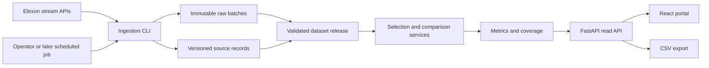

# Wind Forecast Decision Support Implementation and Delivery Plan

Version 5 · 29 October 2026 · Phases 1–5 implemented locally

Build a dependable, publicly demonstrable portal that shows which Elexon wind forecast was available before a January 2026 procurement decision and measures its error against the corresponding reported actual. The submission should make the temporal rules, data quality, and evidence easy to inspect, while keeping delivery within the assignment's sixteen-hour limit.

The proposed implementation is a React and TypeScript frontend, a Python FastAPI backend, PostgreSQL, and Docker for reproducible local execution. During Phase 1 the user confirmed an existing Vercel account, making Vercel the selected hosting target. The architecture supports a later operational utility deployment through versioned data, reproducible calculations, controlled releases, and an explicit production acceptance process.

**Current evidence:** Phases 1–5 run locally with an accepted real January PostgreSQL release, a reproducible calculation engine, typed APIs, matching CSV, and three connected React analyst views. Contexts and export links pin the effective filters/release/policies/build; Decision reads forecasts only. Phase 5 passed 43 frontend tests and build checks, then verified the real browser journey, actual downloads, keyboard inspection, and 320/390/1440-pixel layouts. Phase 4's 85 backend tests and earlier source immutability/recovery evidence remain recorded separately. CI, Docker execution, public deployment, video, and submission are later deliverables; Vercel authentication/external PostgreSQL remain unverified. See [Phase 5 status](docs/PHASE_5_STATUS.md), [Phase 4 status](docs/PHASE_4_STATUS.md), and earlier phase records. Research checks and application evidence are recorded separately.

Start with [Project phases](docs/PROJECT_PHASES.md) for the build sequence and completion gates. For a short company-facing overview, see [Submission brief](docs/SUBMISSION_BRIEF.md). For work items and completion evidence, see [Implementation backlog](docs/IMPLEMENTATION_BACKLOG.md). Source-request hashes and per-day coverage are retained in [Elexon verification report](docs/research/elexon_verification.json).

## 1 Product outcome and assignment compliance

The user is a procurement analyst preparing a day-ahead purchase decision. The portal must let that analyst identify the available wind outlook, see its publication time and completeness, and understand the size and direction of historical forecast errors. The technical reviewer must be able to reproduce the result and trace a displayed point to the source records and calculation policy.

The source assignment is `REint Full Stack SWE challenge v4 Shared.docx`. In addition to the pasted requirements, its final section requires submission through a Microsoft form and incognito verification of every submitted link.

| Requirement | Delivery commitment | Evidence required |
| --- | --- | --- |
| Latest forecast available for a purchase decision | Publication-time selection for each target and visible cutoff | Boundary tests and a reproducible UI example |
| Quantitative forecast evaluation | MAE, RMSE, signed bias, P90 absolute error, and coverage | Independent calculation fixture and downloadable results |
| Elexon-only wind data | WINDFOR and FUELHH records where `fuelType=WIND` | Source manifest and ingestion validation |
| January 2026 purchase decisions | January decision calendar and following-day delivery | Boundary test including 1 February |
| React and Python | TypeScript React client and FastAPI service | Frontend build, typed API contract, backend tests |
| Docker | Multi-stage image and Compose with PostgreSQL | Fresh-checkout startup and restart check |
| Vercel or Heroku | Selected Vercel FastAPI deployment with compiled React and external PostgreSQL | Working public HTTPS URL |
| At most sixteen hours | Prioritized scope, recorded time, and reserved contingency | Work log and explicit deferred features |
| Anonymous public GitHub repository | Reviewed public repository with a random name | Logged-out access and release commit |
| README | Directory map, startup, application URL, AI disclosure, methodology | Another developer follows the instructions |
| Video | Unlisted YouTube video; total below ten minutes and each part below five | Logged-out playback and duration check |
| Final submission | [Assignment form](https://forms.cloud.microsoft/r/Ljmf1aWESK) after incognito checks | Actual submission confirmation |

The form and the source's [YouTube guide](https://sites.uab.edu/apex/for-mph-students/youtube-video/) were recovered from DOCX hyperlinks. Their current contents were not accessible during research; recheck them before submission and capture any additional required fields then.

## 2 Scope and priorities

### 2.1 Mandatory pilot scope

Deliver three lightweight views: Decision, Accuracy, and Data and Methodology. Include date and cutoff controls, original source timestamps, actual and forecast charts, clear missing-data states, the primary metrics, CSV export, and immutable dataset identification. Supply a verified January seed dataset so reviewers can start the application without an upstream download.

Include idempotent backfill, basic data-quality checks, essential domain tests, one browser journey, CI, durable storage, the Docker deployment, README, and video. These are part of the pilot, not optional polish.

### 2.2 Enhancements after the core works

Previous-issue revision overlays, WAPE, detailed hour-of-day analysis, hourly-average sensitivity analysis, and prior-outcome context are optional. Add them only after the complete required journey is working and submission time is protected. A production roadmap is documentation; its controls are not claimed to be implemented merely because they appear here.

### 2.3 Business limits

The product uses GB wind generation visible to the system operator, as described in [Elexon's wind documentation](https://bmrs.elexon.co.uk/wind-generation). Explain the metering and geographical scope, including that outturns can include estimates. Label the series “Elexon reported wind outturn” rather than “final settled generation.”

The input does not include the utility's demand, contracted wind share, hedges, other generation, or prices. Present forecast uncertainty and directional exposure; a procurement volume, monetary savings claim, profit estimate, or automated order would require additional scope and data. No additional energy dataset is introduced by this design.

The assignment application is historical replay. Its initial date is a validated January decision, visibly labeled as historical. An October download timestamp is provenance, not a claim of a live January feed.

## 3 Research evidence and remaining assumptions

### 3.1 Complete-window planning verification

Ten public stream requests were made: five WINDFOR publication-window requests spanning 29 December 2025 through the start of 1 February 2026, and five FUELHH settlement-date requests covering 2 January through 1 February. The request URLs, response SHA-256 hashes, byte counts, retrieval instant, and per-decision coverage are recorded in the research report. The retrieval instant was 28 October 2026 UTC, corresponding to 29 October in the user's timezone.

| Check | Observed result |
| --- | ---: |
| Successful requests | 10 of 10 |
| Forecast archive rows returned | 19,856 |
| FUELHH WIND rows returned | 1,488 |
| January decision dates checked | 31 |
| Selected native forecast targets at 09:00 GMT | 744 of 744 |
| Selected native forecast targets at 09:45 GMT | 744 of 744 |
| Direct timestamp matches to actuals at either cutoff | 744 of 744 |
| Exact duplicates or conflicting business keys in retrieved responses | 0 |
| Null or negative generation values in retrieved responses | 0 |

Forecast targets were on minute zero; actual targets were on minutes zero and thirty. The archive count includes publication responses containing targets outside the final decision-analysis window. It is not the metric sample size.

These checks establish feasibility and observed coverage for two cutoffs and this retrieved vintage. They do not establish delivery guarantees, validate every future custom cutoff, resolve all source semantics, or constitute application acceptance. The production backfill must independently reproduce and validate its own manifest. The research report contains response hashes and summaries, not a complete raw-response archive from which to regenerate the data offline.

### 3.2 Verified source contracts

The [Elexon developer portal](https://developer.data.elexon.co.uk/) states that its public APIs require no key and that dataset queries can retrieve superseded publications. The [OpenAPI specification](https://data.elexon.co.uk/swagger/v1/swagger.json) was also read directly.

| Endpoint | Contract to implement |
| --- | --- |
| `/datasets/WINDFOR/stream` | Top-level array; `dataset`, `publishTime`, `startTime`, nullable integer `generation`; publication filters `publishDateTimeFrom` and `publishDateTimeTo` |
| `/datasets/FUELHH/stream` | Top-level array; the above fields plus `fuelType`, `settlementDate`, `settlementPeriod`; settlement-date filters or publication filters, with the two filter families mutually exclusive |

Use the stream endpoints from the assignment: [WINDFOR](https://bmrs.elexon.co.uk/api-documentation/endpoint/datasets/WINDFOR/stream) and [FUELHH](https://bmrs.elexon.co.uk/api-documentation/endpoint/datasets/FUELHH/stream). Supply historical publication windows for WINDFOR; an unfiltered request returns the latest issue and is unsuitable for replay. Request `fuelType=WIND` and validate the returned value independently.

### 3.3 Decisions recorded before coding

| Decision | Pilot policy | Reason and operational follow-up |
| --- | --- | --- |
| January scope | Purchase decision dates, not delivery dates | Closest reading of the brief; confirm with the assessor if clarification becomes available |
| Desk cutoff | Default `09:00 Europe/London`; editable within the decision date | A visible illustrative desk assumption; confirm venue and internal submission buffer before operational use |
| Delivery window | Following UK civil day | Explicitly defined; exchange contractual schedules require separate confirmation |
| Primary comparison | Equal source target timestamps | Implements the brief's matching fields without inventing intervening forecasts |
| Secondary comparison | Two-half-hour actual mean per forecast hour, if added | Separate sensitivity analysis with an explicit interval assumption |
| Actual vintage | Latest source publication inside the frozen dataset release, then key validation | Reproducible reported outturn; an invalid latest key remains visible |

[Nord Pool's N2EX description](https://support.nordpoolgroup.com/support/solutions/articles/8000088463-about-the-n2ex-day-ahead-auction) and [EPEX's trading brochure](https://www.epexspot.com/sites/default/files/2024-09/Trading%20Brochure%202024%20August.pdf) describe different GB auctions. Therefore, “UK day-ahead” does not supply a universal decision cutoff. Confirm the rules effective in January 2026 for any named-venue claim.

## 4 Time and forecast-selection rules

### 4.1 Decision window

For decision date `D` in 1–31 January 2026:

```text
decision_cutoff = D at the selected local time in Europe/London
delivery_start = local midnight at D + 1 calendar day
delivery_end = local midnight at D + 2 calendar days
delivery_window = [delivery_start, delivery_end)
```

The combined required delivery window is `[2026-01-02T00:00:00Z, 2026-02-02T00:00:00Z)`. The 31 January decision includes 1 February delivery; 1 January delivery belongs to a December decision and is excluded from the headline scorecard.

Store UTC-aware instants as PostgreSQL `TIMESTAMPTZ`; use the Python `Europe/London` timezone to construct calendar boundaries. Reject naive source timestamps. Preserve source precision. January has 24 hours and 48 half-hours per civil day, giving 744 expected native hourly targets and 1,488 expected actual half-hours. Synthetic DST tests must cover 23-hour and 25-hour days without expanding the assignment's energy-data scope.

### 4.2 Latest available means latest per target

For each target `t` in the delivery window, select the source key with the greatest `publishTime` satisfying `publishTime <= decision_cutoff`. The equality is inclusive. Perform selection independently for each target because one issue may cover only part of the horizon.

```text
1. Load release-member forecast versions for target t.
2. Keep source publication times at or before the cutoff.
3. Identify the greatest eligible publication time.
4. Resolve that business key to one value and its validation status.
5. Return its value only if that key is valid; otherwise return a reason.
```

**Important integrity rule:** find the latest eligible key before filtering out invalid values. Filtering to valid rows first can conceal a corrupt latest publication by silently substituting an older one. A missing target from a later issue naturally leaves an older per-target publication eligible; display its publication age and any mixed-issue status. A present but conflicting or null latest key is an unavailable point under the default policy. A different fallback policy would require a named version and visible disclosure.

Calculate `forecast_age = cutoff - selected_publish_time` and `lead_time = target_start - selected_publish_time`. Do not label all targets as exactly twenty-four hours ahead. Never use a later issue to fill a historical gap. Use the same selection service for the screen, metrics, and export.

### 4.3 Source publication and actual receipt

Historical eligibility means “published by Elexon by the cutoff.” Downloading records now cannot prove that a desk received them in January. Store `source_published_at`, `first_seen_at`, and ingestion timestamps separately.

A future operational decision snapshot must also respect actual application receipt by its effective cutoff. Historical replay must not reject every January record merely because its first project download occurred in October. Record the availability model as part of the analysis policy.

### 4.4 Keep decision replay separate from retrospective review

The Decision API and view exclude future actuals, later forecasts, and full-month retrospective accuracy. The Accuracy view explicitly uses hindsight to evaluate the forecasts selected at the original cutoff.

If prior-performance context is added to Decision, include only earlier outcomes whose eligible actual publication was available by that cutoff. Define it separately from the monthly report and show sample size. The earliest dates may have insufficient prior completed history. Never use January's future errors to produce a January 1 risk signal.

## 5 Comparison and metric contract

### 5.1 Primary method matching the brief

Use `comparison_policy=source_timestamp_v1`:

```text
F_t = selected WINDFOR generation for source startTime t
A_t = canonical FUELHH WIND generation for the identical startTime t
error_t_MW = F_t - A_t
```

WINDFOR supplies hourly target timestamps; FUELHH supplies half-hour average actuals. The primary scorecard evaluates the reported values at their shared target timestamps. Label this precisely as a source-time comparison; it is not a claim that all half-hours have forecasts or that the two source fields have proven identical averaging semantics. Keep both source resolutions visible in the methodology and export.

For the observed complete month, this produces 744 distinct paired targets. The other 744 half-hour actuals remain visible and available as source data. Do not forward-fill them into additional independent forecast observations. Errors across hours are time-correlated; distinct target count is not a claim of statistical independence.

### 5.2 Optional hourly-mean sensitivity analysis

Under `comparison_policy=hourly_mean_v1`, interpret the forecast at `t` as applying to `[t,t+1 hour)` and compare with `(A_t + A_(t+30m)) / 2`. Require both valid actual components. Label the interval assumption and keep this scorecard separate. Do not average metrics from the two policies together.

Direct source-time matching is the default because the sampled schema does not fully establish the forecast's interval-average meaning. Data-owner acceptance is required before using the hourly interpretation for operational energy calculations.

Observed example for target `2026-01-02T00:00:00Z`:

| Source or calculation | Value |
| --- | ---: |
| Forecast published at 07:30 on 1 January, available at 09:00 | 18,781 MW |
| Forecast published at 09:30 on 1 January, available at 09:45 | 18,699 MW |
| Actual starting at 00:00 on 2 January | 15,228 MW |
| Actual starting at 00:30 on 2 January | 15,505 MW |
| Default source-time error at the 09:00 cutoff | +3,553 MW |
| Optional hourly actual mean | 15,366.5 MW |
| Optional hourly-mean error at the 09:00 cutoff | +3,414.5 MW |

This example shows why the comparison policy must accompany every result. These source values were checked during the original API investigation; they are not a monthly performance claim.

### 5.3 Required metrics

Positive error always means wind was overestimated. Preserve this sign in cards, tooltips, tables, narrative, and CSV.

| Metric | Definition over paired valid targets | Display |
| --- | --- | --- |
| MAE | `mean(abs(error))` | MW |
| RMSE | `sqrt(mean(error * error))` | MW |
| Bias | `mean(error)` | MW; positive means overforecast |
| P90 absolute error | 90th percentile of absolute errors | MW; descriptive historical tail |
| Coverage | Paired valid targets divided by expected targets | Counts and percentage |

For percentile calculation, sort the values and linearly interpolate at index `(n - 1) * 0.9`, fixing this definition in `metrics_v1`. With no paired targets, return null metrics and an explicit reason; zero pairs must never produce zero error. Compute range-level metrics from pooled pairs, not equally weighted daily metrics when coverage differs. Preserve calculation precision and round only for display.

Optional WAPE is `100 * sum(abs(error)) / sum(abs(actual))`, with null when the denominator is zero. Avoid headline MAPE near zero wind. Do not normalize by an invented installed-capacity value or present historical P90 as a calibrated future confidence interval.

### 5.4 Energy and directional interpretation

Calculate actual daily MWh from all valid half-hours using `sum(actual_MW * 0.5 hours)`. Show a partial total with coverage if any component is absent. Source-time errors at hourly timestamps do not by themselves justify a full-day energy-error total.

Forecast MWh, net energy error, gross energy error, and wind-overestimate MWh belong only to the explicitly accepted hourly-interval policy. Net error can cancel opposing misses, so any energy analysis must show gross error as well. These additions are optional for the assignment.

### 5.5 Reconcile every expected target

Return a mutually exclusive evaluation ledger. In order of precedence, each expected target is `forecast_missing`, `forecast_invalid`, `actual_missing`, `actual_invalid`, or `paired`. These counts sum to expected targets. Separately report source-level actual coverage out of the expected 1,488 half-hours, since it has a different denominator.

Keep reason codes such as `CONFLICTING_SOURCE_KEY`, `NULL_GENERATION`, and `NO_PRE_CUTOFF_PUBLICATION`. No inner join may silently drop missing records. Daily and monthly charts must display the same denominator and policy as their exports.

## 6 User experience and acceptance criteria

### 6.1 Decision view

Show the decision date, cutoff, `Europe/London`, resulting delivery window, historical replay label, and dataset release. Default to the latest validated January decision and the illustrative 09:00 cutoff. Changing either control updates all cards, points, and export parameters together.

Display forecast mean of reported target values, peak and minimum source targets, coverage, publication-time range, and age at cutoff. Plot native hourly forecast points with clear gaps. Tooltips identify the target timestamp, forecast MW, publication, age, and quality reason. Do not imply that connecting a chart line establishes an unverified hourly energy profile.

**Accept when:** a user can answer what was available, when it was published, and which targets are missing; the API response contains no future actual fields or retrospective summary values.

### 6.2 Accuracy view

Support a decision-date range and the same cutoff. Display MAE, RMSE, bias, P90, paired coverage, and the selected comparison policy. Overlay forecast values and original half-hour actuals, identifying the points used for metrics. Show daily MAE, signed errors around zero, and a small table of the largest misses. Export exactly the displayed selection.

**Accept when:** changing a cutoff produces a reproducible result; the original 09:00 example gives the source-time error in section 5.2; missing targets reduce coverage and remain visible; a CSV recomputation matches the displayed metrics within documented rounding.

### 6.3 Data and methodology view

Show endpoint links, scope, publication versus receipt distinction, actual-vintage policy, comparison method, missing reasons, raw-response provenance, and application version. Separate the historical dataset retrieval time from forecast age at a replay cutoff. Present the recorded limitations plainly.

**Accept when:** a reviewer can trace a displayed point to its dataset release and source key, identify the formula and denominator, and understand every unpaired target without reading the entire codebase.

### 6.4 Frontend behavior

Use accessible controls, text alternatives for charts, signed labels beyond color, readable UK time formatting, and an accompanying table. Preserve filters in the URL. Cancel obsolete requests and prevent stale responses from overwriting a newer selection. During loading, retain the previous view with an obvious loading state or clear it consistently; never combine new labels with old numbers.

Distinguish loading, empty, partial, unavailable, and failed-refresh states. Treat staleness relative to the selected historical cutoff, not today's date. A freshness threshold for a future operational feed requires a configured policy; the pilot can show age without asserting a service guarantee. Check desktop and narrow layouts and keyboard navigation.

## 7 System architecture

Use a modular Python application and a relational database. The same codebase provides a read API and an ingestion CLI. The production image serves both compiled React assets and FastAPI routes from one origin.



| Layer | Selected technology | Design rule |
| --- | --- | --- |
| Frontend | React, TypeScript, Vite, Recharts, TanStack Query | Presentation and server-state management; no competing metric implementation |
| API | FastAPI and Pydantic | Validated input, versioned DTOs, read-only public routes |
| Domain | Small Python modules | Pure selection, calendar, comparison, and metric functions |
| Persistence | PostgreSQL, SQLAlchemy, Alembic, psycopg | Indexed revisions and explicit migrations |
| Ingestion | HTTPX and CLI commands | Bounded requests and restartable backfill |
| Testing | pytest, Vitest, React Testing Library, Playwright | Domain cases plus essential integrated behavior |
| Delivery | Docker, Compose, GitHub Actions, Vercel | Reproducible local runtime, tested source build, and durable external database |

Pin supported versions and commit `uv.lock` and `package-lock.json`. Verify compatibility during bootstrap using [React](https://react.dev/learn/build-a-react-app-from-scratch), [FastAPI](https://fastapi.tiangolo.com/deployment/docker/), and [SQLAlchemy](https://docs.sqlalchemy.org/en/20/) documentation. A synchronous SQLAlchemy path with synchronous request handlers is adequate; avoid blocking database calls inside asynchronous handlers.

The observed data volume needs neither a message broker nor a distributed cache. Start with one web process, an explicit small database pool, and indexes on `(target_start_utc, source_published_at DESC)`. Measure before adding workers. Multiple worker pools and ingestion connections must fit the selected database tier's connection limit.

## 8 Persistence and release consistency

| Entity | Contents and integrity requirement |
| --- | --- |
| `ingestion_run` | Dataset, requested window, start/end, state, parser version, counts, failure details |
| `raw_batch` | URL/query, receipt time, response SHA-256, size, immutable compressed payload, run ID |
| `forecast_version` | Dataset, target UTC, source publication UTC, generation MW, canonical row hash, source lineage, first-seen metadata |
| `actual_version` | Equivalent fields plus fuel and settlement metadata |
| `dataset_release` | Immutable member IDs, batch hashes, validation results, source vintage, schema/parser versions, creation time |
| Active release pointer | One accepted release ID, changed transactionally after validation |

Preserve source generation as integers and source nulls as nulls. Deduplicate identical versions using the business key and canonical payload hash. A different payload at the same target/publication/fuel key is a conflict. Store both variants, capture that conflict in the candidate release, and do not use ingestion order as truth.

Do not mutate an old release's membership or recorded validation decisions when a later correction arrives. A new release records the change; previously demonstrated results remain reproducible. The operator can restore the previous active pointer without deleting evidence.

Each request reads one release ID once. Every subsequent query is restricted to that release's membership. Generate an `analysis_context_id` from the release, dates, cutoff, comparison policy, availability model, actual-vintage rule, metrics version, and application commit. Include it in JSON, CSV, logs, and browser state. Hold the same release across a chart/export interaction; a refresh can explicitly move the user to a new release.

Cache keys, if caching is introduced, include this complete context. A release identifier alone is insufficient because two cutoffs select different forecasts. Use deterministic ordering and canonical serialization when hashing a context.

For retrospective actuals, resolve the greatest publication time for each target inside the release, then validate the selected key. For any prior-outcome context, first restrict source publication to the historical cutoff. If earlier actual revisions are not recoverable, disclose the limitation rather than substituting the current actual vintage into an as-of claim.

## 9 Ingestion and data-quality workflow

Backfill WINDFOR using daily publication windows, with a 72-hour December lookback, and FUELHH using required settlement dates with `fuelType=WIND`. Source boundaries and observed resolution are checked rather than assumed. Extend a lookback in bounded steps only when needed; no post-cutoff data may resolve an eligible gap.

```text
GET https://data.elexon.co.uk/bmrs/api/v1/datasets/WINDFOR/stream
    ?publishDateTimeFrom=2025-12-31T00:00:00Z
    &publishDateTimeTo=2026-01-02T00:00:00Z

GET https://data.elexon.co.uk/bmrs/api/v1/datasets/FUELHH/stream
    ?settlementDateFrom=2026-01-02
    &settlementDateTo=2026-01-02
    &fuelType=WIND
```

For each batch: record the run, archive the original response, parse and normalize, validate, deduplicate, and checkpoint. Preserve all relevant forecast vintages. Retain original timestamps and check interval grids, required fields, fuel, non-null values, and conflicts. Flag negative wind values for review without silently clipping them or applying an unsupported capacity ceiling.

Build the candidate release only after required requests have succeeded or any structural gaps have been explicitly classified. Validate daily coverage and selection at supported cutoffs. Publish the accepted release and active pointer in one transaction. A failed candidate leaves the existing release intact and produces a visible ingestion failure.

Use a fixed upstream HTTPS base and allowed parameters. Initial settings are concurrency two or less, a five-second connect timeout, thirty-second read timeout, and at most three retries for transient failures, with jitter and `Retry-After`. Do not retry permanent 400 responses indefinitely. Bound response sizes and log source-window failures without credentials or large payload dumps.

The application reads stored releases during normal use. Startup loads the verified bundled seed idempotently if necessary; it does not require a live source download. Scheduled polling is a later production feature using the same CLI, a single-run lock, checkpoints, and overlapping re-fetch windows for corrections. Do not put a scheduler inside every API worker.

## 10 API and export contract

| Route | Parameters | Responsibility |
| --- | --- | --- |
| `GET /api/v1/config` | None | Dates, default cutoff, supported policies, active release |
| `GET /api/v1/decision-view` | `decision_date`, `cutoff_local`, optional `release_id` | Eligible forecasts and coverage; no future actual values |
| `GET /api/v1/accuracy` | `decision_from`, `decision_to`, `cutoff_local`, `comparison_policy`, optional `release_id` | Retrospective pairs, metrics, coverage ledger |
| `GET /api/v1/data-quality` | Optional `release_id` | Source windows, validation outcomes, provenance |
| `GET /api/v1/export.csv` | Same analysis filters and required `mode` | Exact filtered records and provenance |
| `GET /health/live` | None | Process health |
| `GET /health/ready` | None | Database and an accepted release are readable |

Constrain dates to January decisions, range length to thirty-one days, and cutoff to a valid minute of that local date. Validate supplied release IDs and supported policy names. Return 422 for unsupported filters, 404 for an unknown release, 503 when no usable release exists, and 200 with nulls and coverage for valid requests with missing records. Rate limits return 429. Use stable error codes and request IDs.

Register API and health routes before the SPA fallback so unknown API paths return JSON errors. Declare JSON timestamps in UTC ISO 8601 with `Z`; include local labels with offsets where displayed. Keep typed response models distinct between Decision and Accuracy.

Illustrative retrospective point using verified source values:

```json
{
  "target_start_utc": "2026-01-02T00:00:00Z",
  "forecast_mw": 18781,
  "forecast_published_at": "2026-01-01T07:30:00Z",
  "actual_mw": 15228,
  "actual_interval_minutes": 30,
  "error_mw": 3553,
  "comparison_policy": "source_timestamp_v1",
  "status": "paired"
}
```

The response envelope adds the cutoff, delivery bounds, release, analysis context, actual vintage, coverage ledger, and metric version. Real results also include lineage IDs. The example deliberately does not invent a release ID from an unbuilt application.

CSV includes decision date, cutoff, target UTC and local offset, source publication, forecast and eligible actual values, signed and absolute error, comparison policy, reason codes, lineage, release, and context. Decision export excludes future actuals. Escape CSV fields and neutralize formula-prefixed textual cells. Use the same backend result object for API and export to prevent divergence.

## 11 Repository and developer workflow

```text
README.md                         Reviewer entry point and actual published links
IMPLEMENTATION_PLAN.md            This implementation and delivery plan
pyproject.toml / uv.lock          Locked Python dependencies and tooling
Dockerfile / compose.yaml         Production build and local PostgreSQL
app.py / vercel.json              Selected Vercel entry point and build configuration
heroku.yml                        Alternative compatible container deployment manifest
.env.example                     Documented non-secret configuration
backend/app/main.py               API bootstrap and static assets
backend/app/config.py             Validated environment settings
backend/app/api/                  Routes and response contracts
backend/app/domain/               Calendar, selection, comparison, metrics
backend/app/ingestion/            Source client, parsing, validation, backfill
backend/app/persistence/          Models, repositories, dataset releases
backend/app/cli.py                Migrate, seed, backfill, validate commands
backend/migrations/               Alembic schema versions
backend/tests/                    Unit, source-contract, database tests
frontend/src/                     Pages, components, typed API client, hooks
frontend/package-lock.json        Locked frontend dependencies
tests/e2e/                        Critical browser journey
data/snapshots/                   Attributed real January seed and manifest
docs/                             Methodology, operations, decisions, demo script
.github/workflows/ci.yml          Quality gates and image build
```

Commit changes by meaningful vertical slices: source contract, selection/metrics, API, UI, deployment, and handoff. Define proposed CLI commands consistently in the README; do not show a command as tested until it exists. Use one formatter/linter per language, frontend type checking, and a small set of high-value tests. Keep business rules out of route handlers and React components.

The reviewer startup path should be environment-file creation followed by `docker compose up --build`, then `http://localhost:8000`. Document Windows and Unix copy commands. Compose performs database health checking, a one-off migration/seed step, and web startup in a defined order. See [Docker startup-order guidance](https://docs.docker.com/compose/how-tos/startup-order/).

## 12 Deployment and release procedure

### 12.1 Preferred assignment deployment

Use a Node build stage for React, a locked Python dependency stage, and a small supported non-root runtime image. Serve assets and API from one origin, bind to the platform-provided `PORT`, and keep secrets outside image layers. Commit the frontend artifact through the build, not by manually copying a developer's local output.

Use the user-selected Vercel account and its supported [FastAPI deployment](https://vercel.com/docs/frameworks/backend/fastapi): export `app` from the root `app.py`, compile React in the build command, and include its assets for single-origin serving through FastAPI. Confirm authentication, runtime/plan eligibility, external PostgreSQL, region, and budget. See [Vercel setup](docs/VERCEL_SETUP.md). A prepared manifest is not a completed preview deployment.

Persist releases, raw batches, and versions in external managed PostgreSQL, not the function filesystem. Local Compose uses a named database volume. Immutable bundled seed files are inputs, not the writable production database. Respect the database tier's connection limit when Vercel scales function instances; the prepared default uses one pooled connection per instance with no overflow.

### 12.2 Concrete release order

1. Run CI and build the image. Record the commit and image digest.
2. Verify hosting/database access, connection limits, environment variables, and HTTPS configuration.
3. Run backward-compatible migrations once as an operator or release task.
4. Seed or backfill, validate the candidate, and activate an accepted dataset release.
5. Start the web image; verify readiness, static assets, API, date/cutoff interaction, and export.
6. Restart the service and verify that the database release and results persist.
7. Record the deployed commit, image, dataset release, URL, and smoke-test result.

For rollback, preserve the previous image and active dataset release. Roll back code and release pointer only when schema compatibility has been checked. A code rollback does not undo a migration. Prefer expand-and-contract changes; rehearse any destructive migration with a backup and recovery plan outside the pilot scope.

### 12.3 Hosting fallback and cost ownership

Vercel is the selected route. Validate runtime eligibility, bundling, limits, external database access, and the actual preview before declaring hosting ready. The existing Heroku container manifest remains an alternative if a compatible, authorized account becomes available; its [container workflow](https://devcenter.heroku.com/articles/container-registry-and-runtime) requires the supported generation. Docker remains the local/runtime artifact required by the brief, with its actual build verification recorded separately.

Record a cost worksheet for web compute, database, backups, logging, storage, and any ingestion scheduler. Use current quotes, a budget owner, and a spending ceiling before provisioning. The plan makes no free-hosting or price guarantee, and no paid resources have been created during planning. Keep the demo reachable for the agreed evaluation period and document its owner and shutdown date.

## 13 Verification and release evidence

| Test area | Mandatory cases and evidence |
| --- | --- |
| Cutoff selection | Before/after/exact cutoff, multiple issues, mixed per-target issues, no eligible publication |
| Latest-key integrity | Latest null/conflict is visible; an older valid row cannot hide it |
| Date boundaries | 31 January decision maps to 1 February; 1 January delivery is excluded |
| Comparison | Direct timestamp join; no synthetic half-hour forecasts; optional hourly policy requires both components |
| Metrics | Hand-calculated MAE/RMSE/bias/P90; zero pairs; zero WAPE denominator; unequal daily coverage |
| Vintage and leakage | Decision response has no future actuals; prior-outcome mode excludes later revisions |
| Persistence | Retry idempotency, conflicting variants, failed candidate publication, old release immutability |
| Context consistency | Same filters and release yield matching cards, table, chart, and CSV |
| Source resilience | 429, timeouts, malformed payload, permanent query failure, required schema change |
| User journey | Date/cutoff change, accuracy view, gap display, CSV download, keyboard use |
| Deployment | Fresh Docker startup, migration once, restart persistence, public HTTPS and logged-out access |

Include a hand-calculated fixture with errors `+2` and `-2` MW: MAE 2, RMSE 2, bias 0, P90 2. Test a no-pair case returning nulls. Use synthetic edge cases and a small real Elexon contract fixture; keep synthetic data confined to tests. Do not write tests that merely repeat an implementation line.

CI should lint, type-check, run domain and PostgreSQL integration tests, build the frontend, and build the runtime image. The required browser journey runs against a locally seeded service. Ordinary CI uses frozen fixtures and does not depend on Elexon availability. Manual source verification is a separate check.

Collect a release evidence bundle: source manifest, data-quality report, calculation-fixture output, CI link, deployed commit/image/release identifiers, smoke-test result, and public-link checks. Only mark a gate complete when its evidence exists. A research report or screenshot is not proof that deployment or persistence passed.

## 14 Security and operations

### 14.1 Assignment controls

Keep public routes read-only and ingestion operator-only. Validate filters and export bounds, use parameterized SQL, fixed upstream URLs, escaped source text, production-safe error responses, and a configured request-rate limit at the ingress or application boundary. Prefer same-origin hosting; a split deployment requires an explicit frontend-origin allowlist.

Store secrets in platform configuration, run the container as non-root, lock dependencies, scan the image and repository, and retain only non-secret examples. Review files and commit history before publishing the anonymous repository. Keep the supplied assignment DOCX out of the public repository unless its publication is permitted. A random name does not anonymize the GitHub owner or author identity.

The applicable [BMRS data licence](https://www.elexon.co.uk/bsc/data/balancing-mechanism-reporting-agent/copyright-licence-bmrs-data/) and required attribution were verified during Phase 2. The seed, manifest, metadata API, and application footer carry the attribution; see [data attribution](data/ATTRIBUTION.md). Keep it when redistributing data and keep code licensing separate. Do not substitute a different Elexon licence without checking applicability.

### 14.2 Minimum operational visibility

Use structured logs with request/run ID, release, context, source window, duration, counts, and stable error codes. Observe API error rate/latency, database connections, ingestion failures, missing targets, conflicting keys, last accepted release, and forecast age relative to cutoff. Do not log credentials or full payloads.

Separate process liveness, database/read readiness, and decision-data quality. A healthy HTTP server may still have incomplete wind data. Conversely, a failed upstream refresh need not remove a readable accepted historical release. Surface the failed run and preserve good data.

An operations guide must explain re-fetching a failed window, diagnosing a missing target, investigating a conflict, activating a previous release, restarting the app, and restoring PostgreSQL. Each procedure identifies the operator, expected evidence, and rollback point.

### 14.3 Production service objectives

These are proposed acceptance targets to agree and measure, not achieved guarantees:

| Area | Proposed criterion and measurement |
| --- | --- |
| API latency | p95 under 500 ms for a single-day view at 20 concurrent readers in the chosen region; publish dataset, warm/cold conditions, and failure rate |
| UI usability | Main decision view usable within two seconds on an agreed client network; define the measured milestone |
| Read availability | 99.9 percent over a rolling thirty-day window, using an external probe of a representative read route |
| Decision-data availability | Separate deadline check for target coverage, latest-key validity, and source age before the desk's agreed cutoff |
| Backup/recovery | Proposed RPO 24 hours and RTO four hours, achievable only with the chosen backup tier and a timed restore exercise |
| Security | No unresolved critical security findings, least-privilege access, approved dependency/image scans |

An availability percentage does not certify fresh forecasts. Production alerts need a named owner, escalation route, deadline-aware thresholds, and a tested response. Retention, region, audit duration, identity integration, and support hours require client decisions; estimate these from actual requirements rather than promising a universal compliance posture.

### 14.4 Failure response matrix

| Failure or risk | User-visible behavior | Response and proposed owner |
| --- | --- | --- |
| Upstream timeout or rate limiting | Accepted stored release remains available; failed refresh is identified | Bounded retry and resumable window; ingestion operator |
| Missing or invalid latest forecast | Target gap with reason and affected coverage | Inspect archived source key; no hidden substitution; data owner |
| Source schema or cadence changes | Candidate release fails validation or reports a classified gap | Review source contract, update parser/version, replay fixtures; engineering |
| Correction arrives after a release | Original release remains reproducible; new release is separately identifiable | Review changed records and publish an accepted candidate; data owner |
| Chart and export context differ | Prevent inconsistent export and prompt an explicit refresh | Treat as a correctness defect; block release until fixed; engineering |
| Database unavailable | Explained unavailable state and request ID | Restore connectivity or execute tested recovery; platform owner |
| Wrong auction or comparison assumption | Visible pilot policy; no claim of operational approval | Obtain domain sign-off before utility use; product/trading lead |
| Hosting access or budget unavailable | Resolve before depending on a public deployment | Switch to a verified allowed hosting route early; developer/budget owner |

## 15 Sixteen-hour execution plan

The assignment timebox includes research, implementation, tests, deployment, documentation, video, and submission. Planning research already performed is part of the assignment effort; record it honestly and subtract actual elapsed work from the remaining budget. The allocations below are a total-effort planning envelope, not sixteen additional hours after preparation.

| Step | Work package | Hours | Exit evidence |
| --- | --- | ---: | --- |
| 1 | Source/semantics spike, assumptions, and hosting feasibility | 0.75 | Verified contract and recorded policies; viable hosting path |
| 2 | Bootstrap React, FastAPI, PostgreSQL, and deployment skeleton | 0.50 | One vertical request works; deployment access checked |
| 3 | Raw archive, migrations, idempotent backfill, quality report, seed | 2.00 | Full real January release and reproducible manifest |
| 4 | Calendar, latest-key selection, comparison, metrics, domain tests | 1.75 | Hand-checked cases and leakage/integrity tests |
| 5 | Read APIs, analysis context, coverage, CSV | 1.25 | Contract tests and matching API/export results |
| 6 | Decision, Accuracy, Methodology views and visible failure states | 2.50 | Required analyst journey works |
| 7 | Database, UI, browser, accessibility checks and fixes | 1.50 | Critical cases pass against seeded application |
| 8 | Production image, Compose, CI | 0.75 | Clean startup and successful image/CI build |
| 9 | Deploy, validate HTTPS, restart, and public access | 1.00 | Durable hosted results and smoke-test record |
| 10 | README, methodology, operations notes, demo script | 1.00 | Reviewer can reproduce and explain the build |
| 11 | Record and upload unlisted two-part video | 1.00 | Playable video below ten minutes |
| 12 | Final link verification and submission | 0.75 | Incognito checks and actual form confirmation |
| 13 | Contingency | 1.25 | Reserved for source, hosting, or recording problems |
| | **Total** | **16.00** | |

At four hours, require a validated data release and working selection/metric spike. At eight hours, require a usable vertical slice through the UI. At twelve hours, require the core to be deployed and stop adding features. Protect the final four hours for fixes, handoff, video, link checks, and submission. These checkpoints guide reprioritization; actual time in the work log takes precedence over the nominal table.

Cut optional analyses, revision overlays, and visual polish first. Preserve correctness, the public deployment, Docker start, README, and video. Source/hosting access issues should be resolved early; a credible submission cannot depend on a deployment attempt in the final minutes.

## 16 Production entry after the pilot

Use the pilot as a reviewed starting point. A company can evaluate its engineering quality from the reproducible evidence and clear boundaries. Operational utility use requires the following additional gates:

| Gate | Work required | Acceptance owner |
| --- | --- | --- |
| Domain agreement | Confirm January interpretation, auction/product timing, delivery boundaries, source semantics, and comparison policy | Product owner and trading/data specialist |
| Data reliability | Scheduled ingestion, correction windows, single-run lock, historical-vintage handling, frozen received-by-cutoff decisions | Engineering/data owner |
| Identity and access | Corporate OIDC, viewer/operator roles, separate migration/runtime DB roles, administrative audit | Client identity/security team |
| Environment and recovery | Staging, approved region, tested backups and restore, backward-compatible releases and rollback | Platform/operations owner |
| Performance and service | Measured load targets, deadline-aware data monitoring, alert ownership, incident exercises | Engineering and service owner |
| Business acceptance | Analyst walkthroughs, acceptance of limitations and quality states, documented runbook and support handoff | Procurement lead and product owner |

Estimate these work packages after the pilot and access/dependency review. Corporate identity, client approval, source clarification, and procurement are external dependencies; a fixed “production-ready in two weeks” promise would be unsupported. Additional demand, price, or portfolio integrations need their own data contracts, licences, security review, and acceptance tests.

## 17 Presentation and submission

Target a nine-minute video, split into two parts of approximately four-and-a-half minutes. Demonstrate the public application using a recorded release and cutoff. Use observed results; do not claim cost reduction or better trading outcomes without evidence.

| Time | Audience and content |
| --- | --- |
| 00:00–00:40 | Customer problem and what the portal enables |
| 00:40–02:10 | Decision date, delivery window, forecast publication, age, coverage |
| 02:10–03:20 | Change cutoff and explain why the available forecast changes |
| 03:20–04:30 | Accuracy, error direction, a large miss, and export |
| 04:30–05:20 | Technical architecture and repository map |
| 05:20–06:40 | Selection, comparison policy, January boundary, no-hindsight tests |
| 06:40–07:40 | Ingestion, versioned releases, API contract, representative tests |
| 07:40–08:40 | Docker, CI, deployment, recovery boundaries, production gates |
| 08:40–09:00 | Known limitations, AI assistance, and handoff |

README entry points should put the actual deployed URL and video link first, followed by a concise product explanation, directory map, Docker startup, configuration, backfill/test commands, methodology, limitations, and deployment steps. Disclose AI tools explicitly and describe the verification actually performed. Include the demonstrated commit and dataset release. Do not fabricate links or successful test results.

Before publishing, review source-data attribution, secrets, repository visibility, and the random repository name. Before submission, verify every URL in incognito, play the unlisted video logged out, confirm each part is below five minutes, confirm deployment is usable without the owner's account, and follow startup instructions from a fresh checkout. Complete the source's submission form only when the artifacts exist and retain its confirmation.

## 18 Completion criteria

The assignment is ready when all mandatory requirements have evidence, the January data release is traceable, cutoff and comparison semantics are visible, the calculations reproduce from exported records, the Docker path and public app work, and the README/video/form checks are complete.

The central engineering claim is deliberately testable: **for any supported January decision and cutoff, the portal returns the selected source forecast, its provenance, and a reproducible evaluation under an explicit comparison policy.** The production claim is earned later through the operational gates and measured evidence above.
