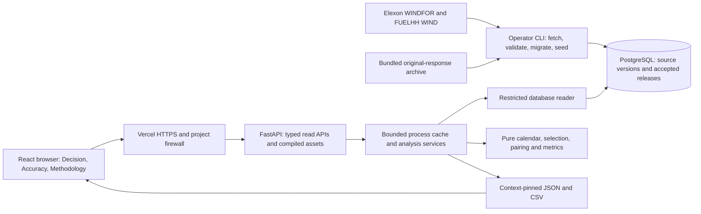

# Architecture and technical review map

Wind Desk serves a historical, public, read-only evaluation workflow. The main integrity boundary is between forecasts eligible at the original decision cutoff and actuals used later for retrospective evaluation.

The operator is the only write path and runs separately from the web request lifecycle. Vercel has only the reader secret. Docker Compose mirrors the application locally with an initializer and separate reader login. Vercel builds a function from source; it does not execute the local Docker image.

| Review concern | Start here | What to inspect |
| --- | --- | --- |
| Calendar/cutoff | `backend/app/domain/calendar.py` | London civil dates, independent UTC boundaries and January decision scope |
| Source selection | `backend/app/domain/sources.py`, `select_latest` | Inclusive cutoff; choose latest eligible key before validating; retain invalid/missing reasons |
| Decision isolation | `backend/app/services/analysis.py`, `decision_response` | Loads forecast versions only; response/export types contain no actuals |
| Pairing and coverage | `backend/app/domain/analysis.py`, `policy.py` | Equal native source timestamps; no forecast interpolation; every expected target reconciles |
| Metrics | `backend/app/domain/metrics.py` | Forecast minus actual; MAE/RMSE/bias; linearly interpolated P90; null metrics with no pairs |
| Dataset identity | `backend/app/persistence/releases.py`, `models.py` | Accepted immutable release membership; invalid imports cannot replace the active release |
| Export identity | `backend/app/services/analysis.py`, `csv_export.py` | Canonical context SHA-256, exact filters/release and stale-context guard; safe CSV text |
| Client state | `frontend/src/state.ts`, `api/`, `views/` | Applied versus draft selection, URL identity, stale responses and failed-refresh preservation |
| Accessibility | `frontend/src/components/Chart.tsx`, `References.tsx`, `motion.css` | Keyboard exact values, dialog focus/Escape, native cursor and reduced motion |
| Concurrency | `backend/app/cache.py`, `services/cached_analysis.py` | Bounded memory/lifetime, same-key work sharing and release resolution before cache lookup |
| Privilege/TLS | `backend/app/persistence/permissions.py`, `database.py` | Restricted reader, timeouts, connection budget and verified TLS trust roots |
| Verification | `backend/tests/`, `frontend/src/*.test.*`, `scripts/verify_service.py`, `frontend/scripts/browser-smoke.mjs` | Temporal integrity, independent CSV arithmetic, actual downloads and responsive browser journey |
| Delivery | `Dockerfile`, `compose.yaml`, `vercel.json`, `.github/workflows/ci.yml` | Locked inputs, separated initialization, non-root local runtime and secret-free CI |

The default `source_timestamp_v1` matches hourly forecast targets with actual records at the same `startTime`. Actuals also contain the intervening half-hours: CSV retains all 1,488 observations, with 744 native comparison targets marked. This avoids inventing forecasts and does not prove equal full-hour averaging semantics. See [methodology](METHODOLOGY.md).

Analysis identity includes the accepted release, parser, policies, applied dates/cutoff and application build. JSON, displayed results and CSV therefore remain reproducible for the selected context. A changed build can change context IDs even when its data/numeric results are unchanged; follow each response's guarded export URL.

The [deployment record](PHASE_7_STATUS.md) describes the tested public setup. The [security guide](SECURITY_AND_SCALING.md) distinguishes implemented controls from distributed scaling, sustained capacity and operational recovery work. The [demo script](DEMO_SCRIPT.md) provides a timed review narrative.
