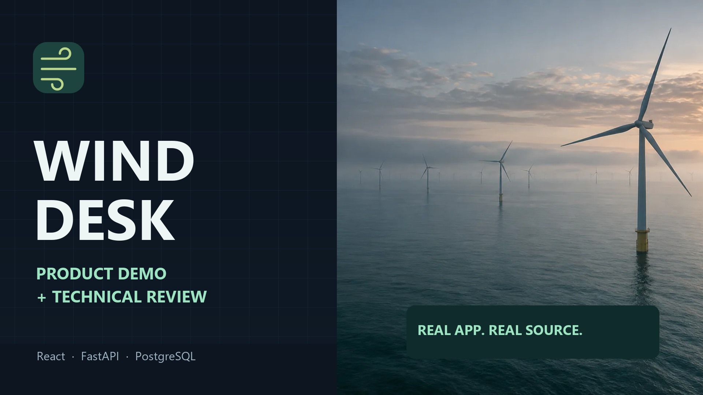

# Wind Desk video production record

Verified 31 October 2026. The complete **9:40.5, 1920 × 1080, nominal 30 fps MP4** has been rendered locally with AI-generated Indian English narration, burned-in subtitles, a separate English SRT file, background music and chapter markers. The final video is an actual rendered artifact; the materials here document it.

**YouTube upload and logged-out playback verification remain pending. No watch URL or completed submission is claimed.** The user's later request for AI narration supersedes the earlier own-voice recording preference.



## Deliverables

The files are in the producing workspace's ignored `output/video/` directory. Large media and raw captures are not committed to application source.

| File | Purpose |
| --- | --- |
| `wind-desk-demo.mp4` | H.264 / AAC, 16:9 Full HD, 580.50 seconds, fast-start playback |
| `wind-desk-demo.srt` | 156 synchronized subtitle cues, also [committed here](video/wind-desk-demo.srt) |
| `wind-desk-thumbnail.png` | 1920 × 1080 cover image suitable for upload |
| `youtube-chapters.txt` | Chapter times for the upload description |
| `production-report.json`, `verification-report.json` | File identities, media checks and limits |
| `storyboard.json`, `timeline.json`, `narration.md` | Editable local production source |
| `recorded/`, `audio/`, `frames/`, `subtitles/`, `segments/` | Retained actual browser captures, neural speech and composition assets |

MP4 size: **24,040,324 bytes**. SHA-256:

```text
44b2ef72c7b40158b09835d59d51052abba7f99be1c3e337e7bf52a4270de589
```

The [voiceover/storyboard](video/VOICEOVER.md) follows the final edit. The [machine evidence](video-production-evidence.json) records the checks and exact source identities. The MP4 must be transferred separately or uploaded before a public playback link can be added to README.

## Content and timing

The customer pilot is 289.23 seconds; the technical review is 291.27 seconds. Each stays below the assignment's five-minute limit, and the whole video stays below ten minutes. All ten requested topics are included; product demonstrations precede the deeper technology review.

| Start | Chapter | Part |
| --- | --- | --- |
| 00:00 | WIND DESK | Customer pilot |
| 00:19 | A decision before delivery | Customer pilot |
| 00:38 | Two questions. One reproducible record. | Customer pilot |
| 01:02 | Live: January 31 at 09:00 | Customer pilot |
| 01:23 | Live: move the cutoff to 09:45 | Customer pilot |
| 01:46 | Live: quantify the miss | Customer pilot |
| 02:11 | Live: drill down and export | Customer pilot |
| 02:33 | Live: inspect the source | Customer pilot |
| 02:56 | Select the latest eligible key first | Customer pilot |
| 03:16 | Metrics follow the documented comparison | Customer pilot |
| 03:41 | One origin for the analyst | Customer pilot |
| 04:04 | A separate operator write path | Customer pilot |
| 04:28 | From an edit to an API request | Customer pilot |
| 04:49 | Frontend: a consistent analyst workspace | Technical review |
| 05:13 | Backend and durable data | Technical review |
| 05:36 | Tools and integrations | Technical review |
| 06:03 | Return a result with its evidence | Technical review |
| 06:27 | A codebase organized around integrity | Technical review |
| 06:53 | The forecast-only boundary is explicit | Technical review |
| 07:13 | Public access. Restricted privileges. | Technical review |
| 07:37 | Bounded work instead of unbounded promises | Technical review |
| 08:01 | Proof from a clean Linux runner | Technical review |
| 08:27 | What is actually deployed | Technical review |
| 08:52 | How updates reach reviewers | Technical review |
| 09:17 | WIND DESK | Technical review |

## Source-backed technical explanations

The walkthrough uses the [real public deployment](https://tme7d41m5t.vercel.app) and [public repository](https://github.com/Mayank2142/tme7d41m5t). Runtime source was inspected at `2e47480d22660ad6ca32581b48dc182a9c6d5388`; the README/gallery publication was inspected at `51fc58c`. The application identifies its deployed build as `77f0793b4d7bdc4cf95e3c8363d1d13f82567363`. The existing [Phase 8 record](PHASE_8_STATUS.md) explains the 89-input runtime comparison, and the [Phase 7 record](PHASE_7_STATUS.md) identifies the database and hosting controls.

| Explanation | Implementation / evidence |
| --- | --- |
| Applied URL state, typed requests, cancellation | `frontend/src/state.ts`, `frontend/src/api/`, `frontend/src/views/` |
| Read routes and validation | `backend/app/api/`, `backend/app/contracts.py` |
| Latest eligible key before quality validation | `backend/app/domain/sources.py`, `select_latest` |
| Forecast-only decision boundary | `backend/app/services/analysis.py`, `decision_response` |
| Equal timestamp pairing and four metrics | `backend/app/domain/analysis.py`, `metrics.py`, [methodology](METHODOLOGY.md) |
| Durable source versions and immutable accepted releases | `backend/app/persistence/models.py`, `releases.py`, `backend/migrations/` |
| Separate operator ingestion | `backend/app/cli.py`, `backend/app/ingestion/` |
| Context-pinned JSON/CSV and bounded caching | `backend/app/services/`, `backend/app/cache.py`, [API contract](API.md) |
| Restricted reader, verified TLS, safe web responses | `permissions.py`, `database.py`, [security/scaling evidence](SECURITY_AND_SCALING.md) |
| Reproducible local Docker and actual Vercel configuration | `Dockerfile`, `compose.yaml`, `app.py`, `vercel.json` |
| CI, container/browser/download/restart proof | `.github/workflows/ci.yml`, [observed successful public run](https://github.com/Mayank2142/tme7d41m5t/actions/runs/41129071765) |

The narration explicitly identifies public read-only access with no sign-in, no predictive AI model, manual CLI deployment after CI, native hourly forecasts against half-hour actuals, and the limits of national wind data. No demand, prices, portfolios, purchase-quantity recommendation, live ingestion scheduler or guaranteed hosted capacity is invented.

## Capture, voice and design

Actual project browser views were captured through the computer-use browser API, including the 09:00 result, a genuine 09:45 draft/Apply transition, the resolved 10,474 MW result, keyboard target inspection, full-month accuracy, daily drill-down, CSV download and reference dialogs. Timestamped captures are edited with holds and scaling; they are not fabricated UI or an uninterrupted real-time recording. Only project tabs were captured. Source-backed diagrams and code panels were composed separately with Pillow and SVG assets; FFmpeg encoded the final video.

Microsoft Edge Read Aloud's `en-IN-PrabhatNeural` voice supplies the complete narration through the [edge-tts client](https://github.com/rany2/edge-tts). Only the public project narration was sent for speech synthesis. A pitch-preserving tempo adjustment produces approximately 143 spoken words per minute. Captions use returned word-boundary timing, adjusted to the edit, and retain the script's punctuation. The synthesized voice does not imitate a named person.

The dark navy, mint and off-white design uses the application's Wind Desk mark, native charts, restrained fades, animated flow indicators and a progress line. The quiet ambient score is an original synthesized chord composition, with no stock track or sampled recording. The existing wind illustration comes from [documented project assets](../frontend/src/assets/README.md); it is illustrative, not measured January weather or an identified generating site.

Technology logos come from the [Devicon project](https://github.com/devicons/devicon). [Exact source URLs and hashes](video/logo-sources.json) and the [MIT licence](video/DEVICON-LICENSE.txt) are retained. Brand marks identify technologies and do not imply endorsement.

**Contains BMRS data © Elexon Limited copyright and database right 2026.** Attribution appears in the closing frame and application. Data rights remain governed by the [source-data attribution](../data/ATTRIBUTION.md).

## Verification and practical limits

- Full video and audio decoding completed without errors; H.264, AAC, 1920 × 1080, nominal 30 fps (29.99 average) and duration were checked from the rendered file.
- All 25 neural narration segments are non-silent. Measured final audio is -15.60 LUFS integrated, with a -3.05 dBTP true peak. Music stays beneath the narration.
- All 156 subtitle cues are ordered, within the timeline, and aligned to the preserved script. The burned-in captions and matching separate SRT are included.
- 19 final-file frames were extracted for visual review, including actual results and both source/context dialogs. Technical values were compared with captured UI state and source evidence.
- This is automated media verification plus selected-frame visual review, not an independent human listen-through or watch-through of the entire video. The original assignment effort limit has not been reconciled.

Before assignment submission, upload the MP4 as **Unlisted**, supply the thumbnail/SRT, verify playback, audio and duration in a logged-out browser, then add the actual watch URL to README and Phase 8 status. The earlier [own-voice script](DEMO_SCRIPT.md) and [recording checklist](RECORDING_CHECKLIST.md) remain an optional alternative.
